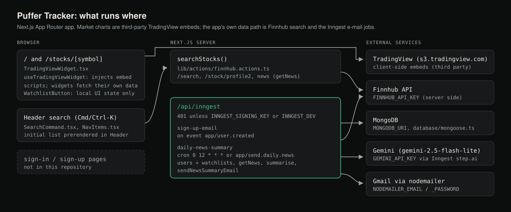
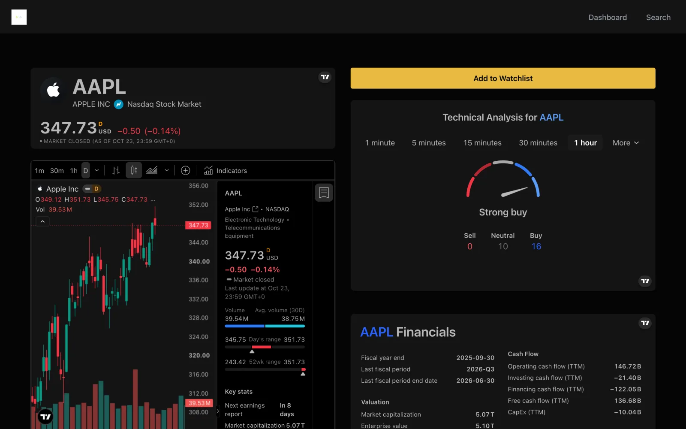

# Puffer Tracker

A Next.js stock dashboard. The charts, heatmap, news and quotes are embedded TradingView widgets; the app's own code
adds ticker search through the [Finnhub](https://finnhub.io) API, a page per symbol, and two Inngest jobs that e-mail
a welcome note and a daily news summary written by Gemini.

 · [Case study ↗](https://hellpuff.dev/work/puffer)



**Status:** experimental, version 0.1.0, not production-ready. It started from the JavaScript Mastery "Signalist"
tutorial app. There is no sign-in and the watchlist is not saved, so it is a read-only dashboard today.

## What you can do in it
1. Open `/` for the market overview, stock heatmap, top stories and market quotes.
2. Press ⌘K (Ctrl-K) or click Search in the header, type a company or ticker, and pick a result.
3. Read `/stocks/<SYMBOL>`: price header, candlestick and baseline charts, technical analysis, company profile and
   financials. The "Add to Watchlist" button toggles, but nothing is stored.

## What the code does
- **Search.** `lib/actions/finnhub.actions.ts` calls Finnhub `/search` for queries and `/stock/profile2` for the
  popular-symbol list shown before you type. The list is fetched in the header on the server.
- **Market widgets.** `components/TradingViewWidget.tsx` injects TradingView's embed scripts in the browser. Prices,
  charts and ratings come from TradingView, not from this app.
- **E-mail jobs.** `/api/inngest` serves two functions from `lib/inngest/functions.ts`: `sign-up-email` on the
  `app/user.created` event, and `daily-news-summary` on cron `0 12 * * *` (UTC) or the `app/send.daily.news` event. The
  daily job reads users and watchlists from MongoDB, fetches Finnhub news per symbol, asks Gemini for a summary and
  sends it with nodemailer over Gmail. These jobs have not been run end to end; they need MongoDB, Inngest, Gemini and
  Gmail credentials.

**Not in this repository**
- Sign-in, sign-up and sessions. The auth pages and the Better Auth route handler are missing; only the helpers
  `lib/better-auth/auth.ts` and `lib/actions/auth.actions.ts` remain. No page passes a user to the header, so the
  user menu (`UserDropdown`) never appears.
- Watchlist storage. The button only changes local component state.
- Alerts.



*Real screenshot of `/stocks/AAPL` from a production build with no API keys. Everything below the header except the
yellow watchlist button is an embedded third-party TradingView widget; the prices, charts, ratings and financials
come from TradingView, not from this app.*

## Quick start
Requires Node.js 22 or newer. Tested with Node 24 and npm 11; CI uses Node 22 and 24.
```bash
git clone https://github.com/hellpuffyt/puffer-tracker.git && cd puffer-tracker
npm ci
cp .env.example .env.local   # then set FINNHUB_API_KEY
npm run dev
```
Open http://localhost:3000. Without `FINNHUB_API_KEY` the app still runs; the TradingView widgets work, the search
list is empty and the server logs `Error in stock search: Error: FINNHUB API key is not configured`.
For a production server, run `npm run build && npm start`.

## Configuration
See [.env.example](.env.example). `FINNHUB_API_KEY` is the only variable the pages need; the rest are for the
e-mail jobs and the auth helpers. The dashboard is prerendered at build time, so set `FINNHUB_API_KEY` before
`npm run build` if you want the popular-stock list in a production build.

`/api/inngest` answers `401 {"message":"Unauthorized"}` unless `INNGEST_SIGNING_KEY` is set (production) or
`INNGEST_DEV=1` is set (local, with the [Inngest dev server](https://www.inngest.com/docs/local-development)); with
`INNGEST_DEV=1` it returns the Inngest introspection JSON listing the 2 functions.

## Project structure
```
app/          routes (App Router): /, /stocks/[symbol], /api/inngest
components/   UI components (shadcn/ui primitives in components/ui)
lib/          Finnhub actions, Inngest jobs, mailer, auth helpers, widget configs
database/     MongoDB connection and watchlist model
tests/        Vitest unit tests
```

## Development
```bash
npm run lint
npm run typecheck
npm test          # vitest; no network, Finnhub calls are mocked
npm run build
npm run test:db   # optional: connects to MONGODB_URI from .env (not .env.local), prints OK or ERROR
```
`npm run lint` currently reports 0 errors and 6 warnings. CI (`.github/workflows/ci.yml`) runs lint, typecheck, test
and build on Node 22 and 24 with no secrets.
[docs/PRODUCTION_READINESS.md](docs/PRODUCTION_READINESS.md) records which commands were run and what was not checked.

## Limitations
- No authentication, no saved watchlist, no alerts.
- The e-mail jobs and live Finnhub calls have not been exercised (no credentials were available).
- On screens narrower than 640 px the header navigation, including Search, is hidden (`hidden sm:block`) and no mobile
  menu replaces it, so search is not reachable on phones.
- AI-generated summaries are inserted into the e-mail HTML without escaping; see
  [docs/PRODUCTION_READINESS.md](docs/PRODUCTION_READINESS.md).

## Security
Report vulnerabilities through a [private GitHub advisory](https://github.com/hellpuffyt/puffer-tracker/security/advisories/new),
as described in [SECURITY.md](SECURITY.md). Keep keys in `.env.local`; `.env*` files other than `.env.example` are
git-ignored.

## Contributing
See [CONTRIBUTING.md](CONTRIBUTING.md). The repository has no license file.
